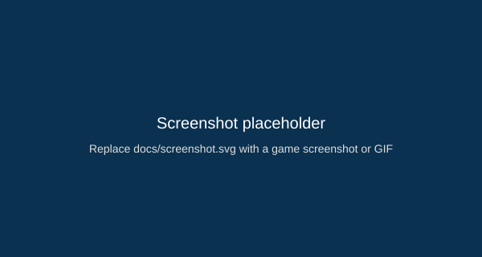

# Jele Runner — 3D Mobile Prototype

A small, offline 3D runner prototype built with native Android (Kotlin + OpenGL ES). Play as Jele, collect coins, buy skins, avoid obstacles — all offline and saved locally.

Badges

Quick links

- Repo: https://github.com/GuardDog98/jele-runner-android
- Playable prototype (Android Studio): open the project in Android Studio and Run

Highlights

- Native Android (Kotlin) with OpenGL ES 2.0 renderer
- Virtual on-screen controls (Left / Jump / Right)
- Coin collection, obstacles, distance scoring
- Skin shop (coins) and local save (SharedPreferences)
- Audio (jeje sound) + vibration feedback
- Start / Game Over overlays and restart

Screenshots / Demo

Controls

- Left / Right (on-screen buttons) — change lane
- Jump (on-screen button) — jump over obstacles

How to run (Android Studio)

1. Clone the repo:

   git clone https://github.com/GuardDog98/jele-runner-android.git
   cd jele-runner-android

2. Open with Android Studio. Wait for Gradle sync to finish.
3. Run on an Android device or emulator with API >= 29 (Android 10).

Build APK (locally)

- From Android Studio: Build → Build Bundle(s) / APK(s) → Build APK(s).
- Or from command line (with JDK 17 and Android SDK):

  ./gradlew assembleDebug
  # result: app/build/outputs/apk/debug/app-debug.apk

Build APK (GitHub Actions)

Contributing

See CONTRIBUTING.md for contribution guidelines.

License

This project is licensed under the MIT License — see the LICENSE file for details.

Thanks

If you like this small project, please give it a star ⭐ on GitHub — it really helps. If you want, I can also prepare a short demo GIF or a Release with APK attached.
